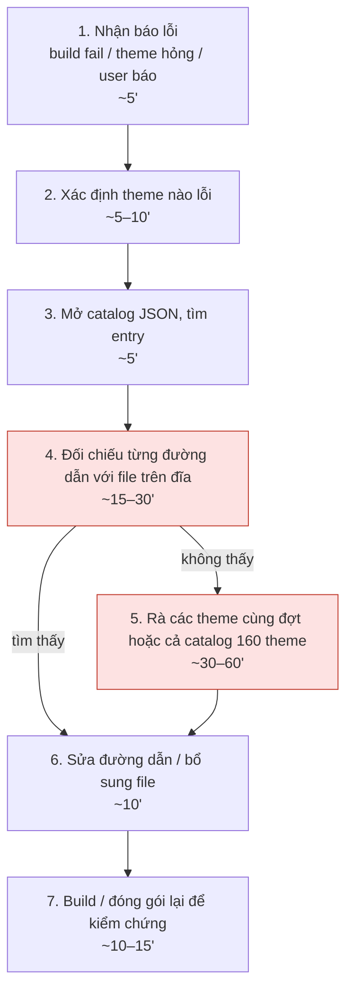
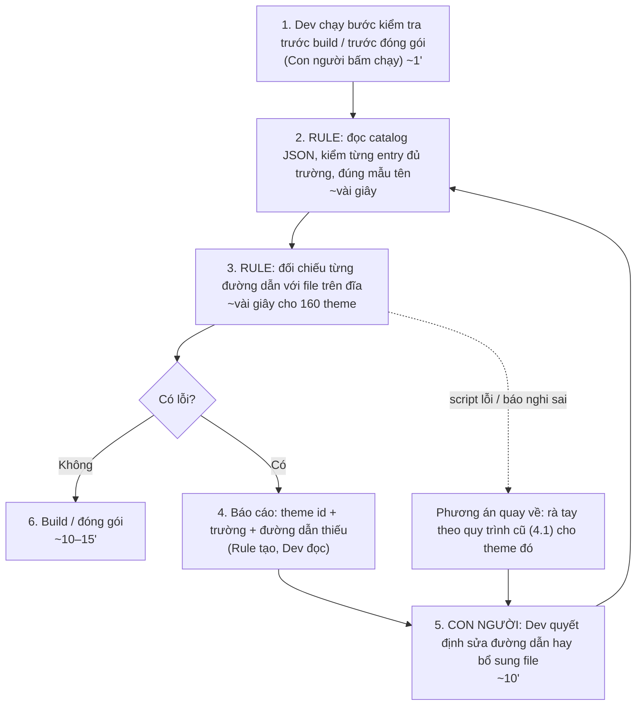

# Báo cáo nhóm — Day 02 Discovery & Problem Framing

> Bản chung của nhóm, viết trên repo do nhóm trưởng fork. Không copy file này sang repo cá nhân.
> Template chi tiết và prompt mẫu: [docs/01-worksheet.md](../../docs/01-worksheet.md). Bài mẫu: [docs/02-deliverable-example.md](../../docs/02-deliverable-example.md).

## 1. Thông tin nhóm

- Tên nhóm: T075
- Thành viên: xem `TEAM.md`
- Candidate problem được chọn (1 câu): Khi một theme bàn phím bị báo lỗi thiếu file, dev muốn biết ngay file nào, theme nào để không phải rà tay cả catalog 160 theme (Đạt #2).
- Quyết định cuối: **Go, phạm vi nhỏ** (đề xuất; xem mục 8, cần nhóm xác nhận)

---

## 2. Hội tụ nhóm (CP3)

### 2.1. Pitch

| # | Người đưa ra | Candidate (Job Story ngắn) | Actor | Bottleneck | Câu hỏi phản biện nhận được (ai hỏi) |
|---:|---|---|---|---|---|
| 1 | Võ Trần Công | Khi nhận yêu cầu xây dựng chatbot AI, tôi muốn hiểu cấu trúc dữ liệu Odoo nhanh hơn để xác định nguồn dữ liệu và phương án tích hợp | AI Engineer, BA, khách hàng | Khảo sát model, field và quan hệ dữ liệu mất 2–4 giờ/dự án | Chưa ghi nhận trong hồ sơ cá nhân |
| 2 | Võ Trần Công | Khi xây dựng pipeline RAG, tôi muốn xử lý bộ tài liệu PDF, DOCX, Excel nhanh hơn để giảm thời gian chuẩn bị dữ liệu | AI Engineer, Data Engineer | Đọc, phân loại, làm sạch và chia nhỏ tài liệu mất 3–5 giờ/bộ | Chưa ghi nhận trong hồ sơ cá nhân |
| 3 | Võ Trần Công | Khi AI Agent chạy sai, tôi muốn truy vết từng bước reasoning, tool call và API để tìm đúng nguyên nhân | AI Engineer, Backend Engineer, QA | Tái hiện lỗi và đọc log mất khoảng 30–60 phút/lỗi | Chưa ghi nhận trong hồ sơ cá nhân |
| 4 | Hà Văn Khánh Đạt | Khi thêm theme bàn phím mới, tôi muốn biết đủ asset cần chuẩn bị để không bị thiếu file khi build | Dev, designer | Rà tay từng file khoảng 30 phút/theme; vẫn có thể sót | Chưa ghi nhận trong hồ sơ cá nhân |
| 5 | Hà Văn Khánh Đạt | Khi theme bị báo thiếu file, tôi muốn biết ngay file và theme lỗi để không phải rà cả catalog 160 theme | Dev | Đối chiếu đường dẫn thủ công, có lỗi id 48, 87 và 97 đã ghi nhận | Chưa ghi nhận trong hồ sơ cá nhân |
| 6 | Hà Văn Khánh Đạt | Khi đóng gói ZIP, tôi muốn mỗi theme có đủ folder và reference để không phải gom file rời | Dev | Gom và copy thủ công mất khoảng 1–2 giờ/đợt 160 theme | Chưa ghi nhận trong hồ sơ cá nhân |
| 7 | Phan Đào Minh Quân | Khi gần deadline bài nhóm, tôi muốn biết ai đã làm gì và phần nào còn thiếu để hoàn thiện báo cáo đúng hạn | Thành viên điều phối, cả nhóm | Hỏi lại phần thiếu mất khoảng 15–30 phút/lần | Chưa ghi nhận trong hồ sơ cá nhân |
| 8 | Phan Đào Minh Quân | Khi chuẩn bị nộp bài, tôi muốn đối chiếu báo cáo với rubric để tránh thiếu mục hoặc sai format | Người kiểm tra cuối | Tìm phần tương ứng trong báo cáo mất khoảng 20–30 phút | Chưa ghi nhận trong hồ sơ cá nhân |
| 9 | Phan Đào Minh Quân | Khi cần nhớ quyết định cũ, tôi muốn tìm được quyết định và lý do để không tranh luận lại từ đầu | Cả nhóm | Mở và đọc nhiều thread mất khoảng 10–20 phút/lần | Chưa ghi nhận trong hồ sơ cá nhân |

### 2.2. Cluster

| Cluster | Các candidate | Pattern chung |
|---|---|---|
| A — Chuẩn bị và hiểu dữ liệu cho hệ thống AI | Công #1, Công #2, Đạt #1 | Nhiều nguồn dữ liệu/field/tài liệu cần đọc, phân loại và chuẩn hóa trước khi xây dựng hoặc tích hợp |
| B — Kiểm tra và vận hành asset/workflow kỹ thuật | Công #3, Đạt #2, Đạt #3 | Lỗi phát sinh trong workflow; cần truy vết, đối chiếu reference hoặc kiểm tra output trước khi giao |
| C — Điều phối và truy hồi thông tin nhóm | Quân #1, Quân #2, Quân #3 | Thông tin phân tán, phải tổng hợp hoặc tìm lại thủ công trước deadline |

### 2.3. Opportunity Solution Tree rút gọn

Gốc là **1 outcome**. Nhánh là **opportunity** (nhu cầu, pain), không phải tính năng hay công cụ.

```text
OUTCOME: Giảm thời gian xử lý thủ công và giảm lỗi trước khi hệ thống hoặc bài nộp được giao
├── Opportunity A: Nguồn dữ liệu và tài liệu đầu vào chưa được chuẩn hóa, khiến bước khảo sát/chuẩn bị kéo dài
├── Opportunity B: Lỗi trong workflow, reference hoặc log khó được phát hiện và truy nguyên sớm
└── Opportunity C: Thông tin nhóm phân tán, khiến việc tổng hợp, đối chiếu và tìm quyết định bị lặp lại
```

Những ý đã gạch bỏ vì là solution đội lốt opportunity:

- “Dùng AI để tự khảo sát Odoo”
- “Xây pipeline RAG tự động”
- “Tạo dashboard log cho Agent”
- “Viết script kiểm tra file asset”
- “Tạo chatbot quản lý tiến độ nhóm”

Đây là các hướng giải pháp; nhóm giữ lại pain và quy trình tương ứng để so sánh trước khi chọn công cụ.

### 2.4. Chấm điểm shortlist (1–5)

| Candidate | Actor rõ | Quy trình rõ | Pain có bằng chứng | Impact đo được | Vừa sức lab | So sánh được No AI/Rule/Workflow/Agent | Nhóm hiểu domain | Tổng |
|---|---:|---:|---:|---:|---:|---:|---:|---:|
| Công #2 — Chuẩn bị tài liệu hỗn hợp cho RAG | 5 | 5 | 4 | 4 | 4 | 5 | 4 | 31 |
| Đạt #2 — Chẩn đoán file thiếu trong catalog | 5 | 5 | 5 | 5 | 5 | 5 | 5 | 35 |
| Quân #1 — Tổng hợp tiến độ và phần thiếu trước deadline | 5 | 4 | 2 | 4 | 5 | 4 | 4 | 28 |

Điểm “Pain có bằng chứng” được chấm theo nội dung hiện có trong ba báo cáo cá nhân: các lỗi asset của Đạt có ví dụ cụ thể; Công có baseline thời gian nhưng còn ghi cần xác nhận; Quân ghi rõ các số liệu là ước tính chưa có log.

**Candidate được chọn:** Chọn **Đạt #2 — Khi một theme bị báo lỗi thiếu file, tôi muốn biết ngay file nào và theme nào để không phải rà cả catalog 160 theme**.

**Vì sao chọn:** Candidate có actor rõ, quy trình 3–7 bước, bottleneck cụ thể ở bước đối chiếu reference, impact đo được bằng thời gian và số lỗi, đồng thời có bằng chứng cụ thể về id 48, id 87 và id 97. Phương án No AI/Rule cũng rõ nên nhóm có thể kiểm tra giả thuyết đơn giản trước khi cân nhắc Workflow hoặc Agent.

**Vì sao loại các candidate còn lại:** Công #2 có pain đáng kể nhưng bottleneck “làm sạch” còn là giả thuyết và tiêu chí “đủ sạch” chưa chốt. Quân #1 có quy trình phù hợp nhưng số liệu hiện mới là ước tính, chưa có log hoặc kiểm chứng. Các card còn lại được giữ làm candidate dự phòng; Công #1 và Đạt #1 có thể gộp vào nhóm chuẩn hóa đầu vào, còn Đạt #3 gần cùng workflow với Đạt #2.

**Xử lý bất đồng (nếu có):** Chưa có biên bản bất đồng hoặc câu hỏi phản biện được ghi nhận trong các file cá nhân. Vì vậy, lựa chọn trên là quyết định tạm thời theo bảng điểm, cần xác nhận lại với cả ba thành viên trước CP4; không coi các câu hỏi ở cột Pitch là câu hỏi đã thực sự được hỏi.

---

## 3. Kiểm chứng + research giải pháp đã có (CP4)

### 3.1. Assumption Map

| # | Giả định | Loại (Value / Usability / Feasibility / Viability) | Quan trọng (1–5) | Đã có bằng chứng (1–5) | Kiểm chứng trước? |
|---:|---|---|---:|---:|---|
| 1 | Người khác làm sản phẩm có nhiều asset (theme, sticker, skin game…) cũng gặp lỗi thiếu file / sai đường dẫn, không chỉ một mình Đạt | Value | 5 | 1 | Có |
| 2 | Lỗi thiếu file xảy ra đủ thường xuyên (vài lần/tháng) để đáng giải | Value | 5 | 2 | Có |
| 3 | Mỗi lần gặp lỗi, phần lớn thời gian mất ở bước tìm file nào lỗi, không phải ở bước sửa | Value | 4 | 4 | Không (đã có từ quy trình của Đạt) |
| 4 | Catalog JSON có đủ thông tin để máy tự đối chiếu với file trên đĩa | Feasibility | 4 | 4 | Không (catalog đã ghi đường dẫn từng asset) |
| 5 | Nguyên nhân chủ yếu là đường dẫn sai / đặt tên sai, kiểm được bằng luật cố định | Feasibility | 4 | 3 | Có, nếu còn thời gian |
| 6 | Người làm theme chịu chạy một bước kiểm tra trước khi build/đóng gói | Usability | 3 | 2 | Không (để sau) |

*Điểm "quan trọng" và "đã có bằng chứng" là đề xuất ban đầu, nhóm điều chỉnh sau khi thảo luận.*

Giả định nhóm kiểm chứng trong buổi này: #1 và #2 (quan trọng cao, bằng chứng thấp). Bộ câu hỏi ở mục 3.2.

### 3.2. Kiểm chứng

Cách đã dùng: Log, ticket, review (đọc lại các lỗi đã ghi nhận trong hồ sơ cá nhân của Đạt). **Chưa thực hiện phỏng vấn hoặc survey.** Phần này cần nhóm làm thật, không điền thay.

**Bộ câu hỏi phỏng vấn (The Mom Test, 10–15'/người)** — hỏi bạn học nhóm khác hoặc dev/designer làm sản phẩm có nhiều asset; không hỏi thành viên nhóm mình; ghi theo vai trò, không ghi tên thật.

1. Bạn đang làm sản phẩm gì, có khoảng bao nhiêu file asset (ảnh, âm thanh, font, config)?
2. **Lần gần nhất** app/build bị lỗi vì thiếu file hoặc sai đường dẫn là khi nào? Kể lại từ lúc phát hiện tới lúc sửa xong.
3. Lúc đó bạn làm thế nào để biết **file nào** bị lỗi? Mất bao lâu?
4. Trong tháng vừa rồi chuyện này xảy ra mấy lần?
5. Bước nào mất thời gian nhất: tìm ra lỗi, sửa, hay build/đóng gói lại?
6. Lỗi có từng lọt tới người dùng chưa? Chuyện gì xảy ra sau đó?
7. Hiện bạn phòng trước bằng cách nào (checklist, script, quy ước đặt tên, review)? Đã thử gì mà không hiệu quả?
8. Bạn có thể cho xem một ví dụ thật không (log lỗi, tin nhắn báo lỗi, commit sửa)?

Không hỏi: "Bạn có muốn tool tự kiểm tra không?", "Ý tưởng này hay không?", "Bạn có dùng không?".

**Survey dự phòng (5–10 người):** có làm sản phẩm nhiều asset không · số lần gặp lỗi thiếu file/sai đường dẫn trong 1 tháng (0 / 1–2 / 3–5 / >5) · lần gần nhất mất bao lâu để tìm ra file lỗi (<5' / 5–15' / 15–60' / >60') · bước tốn thời gian nhất · đang xử lý thế nào · mức đáng giải (1–5).

*Bộ câu hỏi soạn có hỗ trợ của AI (Claude); kết quả bên dưới phải từ người thật.*

Interview snapshot (mỗi buổi phỏng vấn một bảng, hoặc đặt file trong `report/assets/cp4-interview-snapshot-N.md`):

| Trường | Nội dung |
|---|---|
| Người được hỏi (vai trò, không ghi tên thật) | *(chưa phỏng vấn)* |
| Câu nói đáng nhớ nhất (nguyên văn) | *(chưa phỏng vấn)* |
| Lần gần nhất gặp vấn đề này: chuyện gì đã xảy ra? | *(chưa phỏng vấn)* |
| Hiện đang xử lý bằng cách nào (workaround)? | *(chưa phỏng vấn)* |
| Mất bao lâu, bao lần? | *(chưa phỏng vấn)* |
| Insight / opportunity rút ra | *(chưa phỏng vấn)* |

Tổng hợp:

| Nguồn | Số người / số mẫu | Tín hiệu xác nhận | Tín hiệu phản bác |
|---|---:|---|---|
| Hồ sơ cá nhân của Đạt (lỗi đã ghi nhận trong catalog) | 3 lỗi cụ thể (id 48, 87, 97) | Lỗi thiếu file có thật và lọt vào dữ liệu: id 48 trỏ tới file không tồn tại, id 87 thiếu popup, id 97 var4 trả 404 | Thời gian 30–60 phút là ước lượng, chưa bấm giờ; Đạt cũng ghi chưa chắc nguyên nhân là sai tên, chưa tạo file hay catalog ghi sai đường dẫn |
| Phỏng vấn / survey dev khác | 0 | *(chưa có)* | *(chưa có)* |

**Nhóm đã sửa problem thế nào sau kiểm chứng:** Chưa sửa, vì chưa có phỏng vấn hoặc survey. Sau khi có dữ liệu, nhóm cập nhật dòng này, đặc biệt là giả định 3 (bước nào tốn nhất) và giả định 5 (nguyên nhân gốc của lỗi thiếu file).

### 3.3. Research giải pháp đã có

| Công cụ / case / pattern | Link | Giải bước nào trong quy trình? | Điểm mạnh | Khoảng trống / rủi ro | Bài học cho nhóm |
|---|---|---|---|---|---|
| Android Lint (công cụ kiểm tra tĩnh có sẵn trong Android Studio/Gradle) | [developer.android.com/studio/write/lint](https://developer.android.com/studio/write/lint), [check UnusedResources](https://googlesamples.github.io/android-custom-lint-rules/checks/UnusedResources.md.html) | Phát hiện sớm (trước bước 1): chạy lúc build | Có sẵn, chạy tự động trong Gradle, cấu hình được bằng `lint.xml` | Kiểm tra resource trong `res/` mà code tham chiếu; **không đọc catalog JSON** nên không biết đường dẫn asset ghi trong catalog có tồn tại không | Pattern "kiểm tra lúc build, báo lỗi trước khi giao" là đúng; cần một bước kiểm tra riêng cho catalog |
| JSON Schema + validator (ví dụ Ajv) | [json-schema.org](https://json-schema.org/), [ajv.js.org](https://ajv.js.org/) | Bước 3–4: kiểm entry catalog đúng format (đủ trường, đúng kiểu, đúng mẫu tên file) | Chuẩn mở, báo lỗi chỉ đúng trường nào của entry nào | Chỉ kiểm **format**, không kiểm file có tồn tại thật trên đĩa; vẫn cần thêm bước đối chiếu file | Tách 2 loại lỗi: sai format (schema bắt được) và thiếu file (cần đối chiếu đĩa) |
| Firebase Crashlytics — ghi lỗi non-fatal | [Customize crash reports for Android](https://firebase.google.com/docs/crashlytics/android/customize-crash-reports) | Bước 1–2: biết theme nào lỗi trên máy người dùng | Ghi được lỗi không làm crash app (`recordException`) kèm custom key, ví dụ theme id, tên file | Chỉ biết **sau khi** lỗi đã lọt ra người dùng; báo cáo gửi theo lô ở lần mở app sau | Dùng làm lưới an toàn cuối, không thay được kiểm tra trước khi giao |

*Research có hỗ trợ của AI (Claude). Nhóm cần tự mở và kiểm từng link trước khi nộp.*

---

## 4. Quy trình trước/sau (CP5)

### 4.1. Quy trình hiện tại

Sơ đồ (nháp từ Problem Card #2 của Đạt; cập nhật số phút sau kiểm chứng CP4):



| Bước | Actor | Input | Output | Thời gian / tần suất | Ghi chú |
|---:|---|---|---|---|---|
| 1 | Dev | Build fail, theme hỏng trên máy, hoặc user báo | Biết có lỗi | ~5' | Thông báo lỗi đôi khi chung chung |
| 2 | Dev | Thông báo lỗi | Theme id bị lỗi | ~5–10' | Có lúc phải đoán |
| 3 | Dev | Theme id, catalog JSON | Entry của theme | ~5' | |
| 4 | Dev | Entry catalog, thư mục asset | Đường dẫn nào không có file | ~15–30' | Đối chiếu tay từng đường dẫn |
| 5 | Dev | Cả catalog 160 theme, 2.192 file | Danh sách theme/file lỗi | ~30–60' | Chỉ khi bước 4 không tìm ra; ví dụ id 48 |
| 6 | Dev | File/đường dẫn lỗi | Catalog hoặc asset đã sửa | ~10' | |
| 7 | Dev | Catalog + asset đã sửa | Build/ZIP mới | ~10–15' | |

Tổng: ~1–2 tiếng mỗi lần gặp lỗi. Tần suất: cần bổ sung sau kiểm chứng.

**Bottleneck chính:** Bước 4–5, đối chiếu tay từng đường dẫn trong catalog với file trên đĩa (~45–90'/lần). Catalog càng nhiều theme thì càng lâu và càng dễ sót (đã ghi nhận lỗi ở id 48, 87, 97).

### 4.2. Quy trình tương lai

Ghi rõ bước nào **Rule**, bước nào **AI**, bước nào **con người**, **boundary** ở đâu, **phương án quay về** khi AI sai.



- **Rule:** bước 2–4 (kiểm format entry, đối chiếu file tồn tại, xuất báo cáo). Không có bước AI: kiểm tra file tồn tại là bài toán xác định.
- **Con người:** bước 1 (chạy kiểm tra), bước 5 (quyết định sửa thế nào), duyệt trước khi giao.
- **Boundary:** công cụ chỉ **báo** lỗi, không tự đổi tên, tự xóa entry hay tự tạo file thay thế; mọi sửa đổi catalog và asset do dev quyết định.
- **Phương án quay về:** nếu script lỗi hoặc báo nghi ngờ sai (ví dụ file có nhưng khác hoa/thường), dev rà tay theme đó theo quy trình hiện tại ở 4.1.

### 4.3. Before / after

| Chỉ số | Trước | Sau (kỳ vọng) | Ghi chú |
|---|---:|---:|---|
| Số bước | 7 | 6 | Bỏ bước rà cả catalog (bước 5 cũ) |
| Tổng thời gian | ~1–2 tiếng/lần | ~25–30'/lần | Phần lớn còn lại là sửa + build lại |
| Thời gian tìm ra file lỗi | ~45–90' (bước 4–5) | <1' | Metric chính |
| Số bước thủ công | 7 | 3 (chạy kiểm tra, quyết định sửa, build) | |
| Bottleneck chính | Đối chiếu tay đường dẫn với file | Sửa + build lại (~20–25') | Bottleneck chuyển sang bước sửa |
| Rủi ro mới phát sinh | — | Script có bug báo sót/báo nhầm; dev tin script mà bỏ kiểm tra tay | Giữ phương án quay về; kiểm script bằng các lỗi thật id 48, 87, 97 |

*Số "Sau" là kỳ vọng, chưa đo. Nhóm cập nhật sau khi thử.*

---

## 5. Problem Statement v0 (CP5)

| Trường | Nội dung |
|---|---|
| **Actor** | Dev làm data theme bàn phím (người xử lý lỗi thiếu file khi build hoặc khi kiểm tra catalog) |
| **Quy trình** | Nhận báo lỗi → xác định theme lỗi → mở catalog JSON → đối chiếu từng đường dẫn với file trên đĩa → (nếu không thấy) rà các theme cùng đợt hoặc cả catalog 160 theme → sửa → build lại (7 bước, ~1–2 tiếng/lần) |
| **Bottleneck** | Bước 4–5: đối chiếu tay từng đường dẫn trong catalog (160 theme, 2.192 file) với file trên đĩa, ~45–90 phút mỗi lần |
| **Impact** | Theme thiếu file có thể lọt ra tay người dùng (đã ghi nhận id 48, 87, 97); mỗi lần sửa phải build và đóng gói lại; thời gian rà tay tăng theo số theme trong catalog |
| **Success Metric** (baseline → target, cách đo) | Thời gian tìm ra file lỗi: ~45–90' → dưới 1' mỗi lần; số theme lỗi lọt qua kiểm tra: 1–2 mỗi đợt → 0. Cách đo: bấm giờ trên các lỗi thật và đếm lỗi còn lại sau mỗi đợt build |
| **Boundary** (AI không được làm gì; khi nào cần con người kiểm tra — HITL) | Công cụ chỉ báo lỗi, không tự đổi tên, tự xóa entry hay tự tạo file. Dev đọc báo cáo và quyết định sửa. Khi công cụ báo nghi ngờ hoặc script lỗi, dev rà tay theme đó theo quy trình cũ |

Phản biện nhận được (từ AI hoặc nhóm khác) và nhóm có đồng ý không:

- **Chưa có phản biện nào được ghi nhận** từ AI hoặc nhóm khác. Phần này cần nhóm nhờ AI hoặc nhóm khác phản biện Problem Statement v0 (chỉ hỏi lỗ hổng, không để viết lại) rồi điền: điểm yếu, nhóm có đồng ý không, đã sửa gì.
- Câu hỏi gợi ý để hỏi: Baseline 45–90' dựa trên cách đo nào? Lỗi thiếu file có thể do nhiều nguyên nhân (sai tên, chưa tạo file, catalog sai)? Nếu công cụ báo sót thì dev có biết không?

---

## 6. Mức can thiệp AI (CP6)

### 6.1. Ma trận độ mơ hồ × độ phức tạp

Bài của nhóm nằm ở ô: **độ mơ hồ thấp × độ phức tạp thấp** (Rule hoặc Workflow đơn giản thường đủ).

Vì sao:

- **Độ mơ hồ thấp:** kết quả có đúng/sai rõ. Một đường dẫn trong catalog hoặc trỏ tới file có thật trên đĩa, hoặc không; không có nhiều đầu ra khác nhau cùng được chấp nhận như khi viết một đoạn văn. Các lỗi đã ghi nhận (id 48 trỏ file không tồn tại, id 87 thiếu popup, id 97 var4 trả 404) đều là lỗi xác định được.
- **Độ phức tạp thấp:** phần cần xử lý là bước đối chiếu (bước 4–5), chỉ dùng hai nguồn dữ liệu là catalog JSON và file trên đĩa, và cùng một phép kiểm tra lặp lại cho từng đường dẫn, không rẽ nhánh. Quy trình tổng thể có 7 bước nối tiếp, nhưng các bước còn lại (nhận báo lỗi, sửa, build lại) là việc của người, không phải phần cần can thiệp.
- Lưu ý còn phải kiểm chứng: nếu phỏng vấn ở CP4 cho thấy nguyên nhân thiếu file có nhiều dạng khác nhau mà luật đối chiếu không bắt hết (giả định 5), độ mơ hồ có thể cao hơn nhóm đang chấm.

### 6.2. So sánh 4 mức

| Mức | Phương án cho bài của nhóm | Đủ khi nào | Rủi ro | Chọn? |
|---|---|---|---|---|
| **No AI** (sửa quy trình) | Checklist cố định theo loại theme và quy ước đặt tên, dev rà tay trước khi build | Số theme ít, lỗi hiếm; checklist đủ để dev không sót | Vẫn rà tay: tốn khoảng 30' mỗi theme và vẫn sót (id 48, 87, 97 đã lọt); với 160 theme và 2.192 file thì không mở rộng được | Không (chỉ giữ checklist làm bước phụ) |
| **Rule** | Script đọc catalog JSON, đối chiếu từng đường dẫn với file trên đĩa, in báo cáo theme id + trường + đường dẫn thiếu; không tự sửa | Lỗi là loại xác định được: file có hoặc không, đường dẫn đúng hoặc sai | Script có bug báo sót hoặc báo nhầm (ví dụ khác hoa/thường); dev tin script mà bỏ kiểm tra tay | **Có** |
| **Workflow** | Rule ở trên cộng thêm một bước dùng AI, ví dụ đoán nguyên nhân (sai tên, chưa tạo file, catalog ghi sai) hoặc gợi ý file gần đúng | Khi nguyên nhân có nhiều dạng mà luật không phân loại được | Thêm chi phí và rủi ro đoán sai; gợi ý sai có thể làm dev sửa nhầm | Không (hiện chưa có bằng chứng cần) |
| **Agent** | AI tự quét catalog, tự quyết cần kiểm gì, tự sửa đường dẫn hoặc tạo file thay thế | Khi không biết trước cần kiểm gì và cần nhiều bước phụ thuộc nhau | Tự sửa catalog hoặc asset có thể làm hỏng dữ liệu thật; khó kiểm và khó quay về | Không |

**Mức chọn:** **Rule**.

**Vì sao không chọn mức đơn giản hơn:** Mức đơn giản hơn là No AI (checklist và rà tay). Mức này đã là cách làm hiện tại và vẫn để lọt lỗi: dev rà tay khoảng 30' mỗi theme mà id 48, 87 và 97 vẫn lọt vào dữ liệu thật. Rà tay cả catalog 160 theme (2.192 file) tốn thêm 30–60' mỗi lần. Vì việc cần kiểm là xác định (file có hay không), một bước kiểm tra tự động bằng luật giải đúng bottleneck mà không cần AI. Chưa chọn Workflow hay Agent vì chưa có bằng chứng nguyên nhân thiếu file có nhiều dạng mà luật không bắt hết (giả định 5 ở CP4 còn chưa kiểm chứng).

### 6.3. AI Canvas rút gọn

Bài của nhóm dùng mức Rule, không có AI. Canvas dưới đây ghi phần "máy" là luật xác định, để nhóm nhìn rõ chỗ nào máy làm, chỗ nào người quyết.

| Thành phần | Nội dung |
|---|---|
| **Prediction** — AI dự đoán / tạo ra gì? | Không có AI dự đoán. Luật xác định tạo ra danh sách: theme id, trường catalog và đường dẫn nào không có file thật trên đĩa. Đây là kết quả đúng/sai, không phải ước đoán |
| **Judgment** — con người cân nhắc, quyết định gì? | Dev quyết định lỗi là sai đường dẫn, sai tên hay chưa tạo file, và sửa bằng cách nào; đồng thời quyết định tin hay rà tay lại khi báo cáo nghi ngờ (ví dụ khác hoa/thường) |
| **Action** — hành động cuối cùng là gì, ai làm? | Dev sửa đường dẫn hoặc bổ sung file, rồi build/đóng gói lại. Công cụ chỉ báo lỗi, không tự sửa |
| **Outcome** — đo kết quả bằng gì? | Thời gian tìm ra file lỗi (từ khoảng 45–90' xuống dưới 1'); số theme lỗi lọt qua kiểm tra mỗi đợt (từ 1–2 xuống 0); kiểm công cụ bằng các lỗi thật id 48, 87, 97 |
| **Input** — AI cần dữ liệu đầu vào gì mỗi lần chạy? Có sẵn không? | Catalog JSON và thư mục asset trên đĩa (160 theme, 2.192 file). Cả hai đều có sẵn, không cần dữ liệu ngoài |
| **Feedback** — lấy phản hồi ở đâu để cải thiện? | Dev ghi lại lần báo nhầm hoặc bỏ sót; kết quả build/đóng gói sau khi sửa; số lỗi lọt ra tay người dùng sau mỗi đợt giao |

### 6.4. Hai câu hỏi của Google PAIR

- Người dùng muốn **được hỗ trợ (augment)** hay **giao hẳn việc (automate)**? **Được hỗ trợ.** Dev muốn biết ngay file nào thiếu, nhưng việc sửa (đổi đường dẫn, bổ sung file, đổi tên) vẫn do dev quyết, vì sửa sai catalog hoặc asset có thể làm hỏng dữ liệu thật. Bằng chứng: lỗi đã lọt vào dữ liệu (id 48, 87, 97) và boundary ở mục 4.2 cho phép công cụ chỉ báo, không tự sửa. Bằng chứng này hiện chỉ đến từ Đạt; cần xác nhận với dev khác ở CP4.
- AI sai kiểu nào tệ hơn, **báo nhầm** hay **bỏ sót**? **Bỏ sót tệ hơn.** Báo nhầm chỉ làm dev mất vài phút kiểm lại một đường dẫn; bỏ sót làm theme thiếu file lọt ra tay người dùng, phải sửa và đóng gói lại. Thiết kế xử lý: luật đối chiếu tất cả đường dẫn trong catalog (không lấy mẫu), báo mọi nghi ngờ (kể cả khác hoa/thường), kiểm công cụ bằng các lỗi thật id 48, 87, 97, và giữ phương án quay về rà tay. (Ở mức Rule, khái niệm này áp dụng cho luật chứ không phải mô hình AI.)

---

## 7. Problem Statement v1 + tiêu chí đánh giá (CP6)

| Trường | Nội dung |
|---|---|
| **Actor** | Dev làm data theme bàn phím (người xử lý lỗi thiếu file khi build hoặc khi kiểm tra catalog) |
| **Quy trình** | Chạy bước kiểm tra trước build/đóng gói → luật đọc catalog và đối chiếu từng đường dẫn với file trên đĩa → xuất báo cáo (theme id, trường, đường dẫn thiếu) → dev sửa → chạy lại; còn lại như quy trình ở mục 4.2 |
| **Bottleneck** | Đối chiếu tay từng đường dẫn trong catalog với file trên đĩa (~45–90' mỗi lần) |
| **Impact** | Theme thiếu file lọt ra tay người dùng, phải sửa và đóng gói lại; thời gian rà tay tăng theo số theme |
| **Success Metric** (baseline → target, cách đo) | Thời gian tìm ra file lỗi: ~45–90' → dưới 1'. Theme lỗi lọt qua kiểm tra: 1–2 mỗi đợt → 0. Số lỗi thật bị bỏ sót (kiểm bằng id 48, 87, 97 và các lỗi mới): 0. Cách đo: bấm giờ trên lỗi thật, đếm lỗi còn lại sau mỗi đợt build |
| **Boundary** | Công cụ chỉ **báo** lỗi, không tự đổi tên, xóa entry hay tạo file thay thế. Dev duyệt mọi sửa đổi. Khi công cụ báo nghi ngờ hoặc script lỗi, dev rà tay theme đó theo quy trình cũ |
| **AI intervention point** | Không có. Bài toán dùng luật xác định (đối chiếu đường dẫn); AI chưa được đưa vào |
| **Mức chọn** | **Rule** |
| **Rủi ro & người kiểm tra** | Luật báo sót hoặc báo nhầm; dev tin kết quả mà bỏ kiểm tra tay. Người kiểm tra: dev làm data theme (người chạy công cụ) và người duyệt trước khi giao |

**Thay đổi so với v0 và lý do:**

| Trường | v0 | v1 | Vì sao đổi |
|---|---|---|---|
| Success Metric | Hai chỉ số: thời gian tìm file lỗi và số theme lỗi lọt qua | Thêm chỉ số số lỗi thật bị bỏ sót = 0, kiểm bằng id 48, 87, 97 | Mức Rule dễ báo sót hơn là báo nhầm; câu PAIR ở mục 6.4 cho thấy bỏ sót tệ hơn nên cần đo trực tiếp |
| Boundary | Công cụ chỉ báo lỗi; rà tay khi nghi ngờ | Giữ nguyên, thêm Dev duyệt mọi sửa đổi và người duyệt trước khi giao | Làm rõ ai là người kiểm tra (HITL) sau khi chọn mức |
| AI intervention point | Chưa có trường này | Không có (chọn Rule) | Ghi rõ vì sao không dùng AI |
| Mức chọn | Chưa có | Rule | Kết quả so sánh 4 mức ở mục 6.2 |
| Rủi ro & người kiểm tra | Chưa có | Báo sót/nhầm, dev quá tin công cụ; dev và người duyệt kiểm | Rủi ro mới phát sinh sau khi chọn Rule |

**Tiêu chí đánh giá đầu ra của công cụ kiểm tra (3–5 tiêu chí).** Vì chọn mức Rule, "đầu ra" là báo cáo lỗi của luật, không phải đầu ra của mô hình AI:

| # | Tiêu chí | Đạt khi | Không đạt khi |
|---:|---|---|---|
| 1 | Bắt đủ lỗi đã biết | Báo đúng cả id 48, 87 và 97 khi chạy trên catalog 160 theme | Bỏ sót ít nhất 1 trong 3 lỗi đã biết |
| 2 | Báo cáo đủ thông tin để sửa | Mỗi lỗi có theme id, trường catalog và đường dẫn thiếu | Chỉ báo "có lỗi" hoặc thiếu một trong ba thông tin |
| 3 | Không báo nhầm quá nhiều | Dev kiểm lại thấy phần lớn cảnh báo là lỗi thật (ngưỡng nhóm chốt sau khi thử) | Nhiều cảnh báo là nhầm đến mức dev không còn tin công cụ |
| 4 | Không tự thay đổi dữ liệu | Công cụ không sửa hay xóa catalog và asset | Công cụ tự đổi tên, xóa entry hoặc tạo file |
| 5 | Chạy nhanh | Chạy hết 160 theme trong vài giây đến dưới 1 phút | Chạy lâu hơn việc rà tay |

---

## 8. Quyết định (CP6)

### 8.1. Bốn rủi ro

| Rủi ro | Câu hỏi | Mức độ rủi ro (Thấp = an toàn / TB / Cao = nguy hiểm) | Lý do / bằng chứng |
|---|---|---|---|
| **Value** | Người dùng có thật sự cần và sẽ dùng không? | Trung bình | Lỗi thiếu file có thật (id 48, 87, 97) và rà tay tốn thời gian, nhưng bằng chứng đến từ Đạt; chưa phỏng vấn dev khác, thời gian 30–60' chưa bấm giờ |
| **Usability** | Người dùng có dùng được, có hiểu và sửa được đầu ra của AI không? | Thấp | Báo cáo chỉ gồm theme id, trường và đường dẫn thiếu; dev đã quen đọc catalog. Rủi ro còn lại là dev quá tin công cụ, đã có phương án quay về rà tay |
| **Feasibility** | Có đủ dữ liệu, công cụ, kỹ năng để làm không? | Thấp | Cần catalog JSON và thư mục asset, cả hai có sẵn; luật đối chiếu đường dẫn là bài toán đơn giản. Cần kiểm giả định catalog ổn định (giả định 4) |
| **Viability** | Có hợp chi phí, pháp lý, quy định tổ chức không? Ai vận hành? | Thấp | Script nội bộ, không dùng dịch vụ trả phí và không đưa dữ liệu ra ngoài. Cần chốt ai bảo trì script (đề xuất: dev làm data theme) |

### 8.2. Kết luận

**Quyết định:** **Go, phạm vi nhỏ** (đề xuất, cần nhóm xác nhận)

**Lý do:** Bài toán có đáp án đúng/sai rõ, thuộc ô độ mơ hồ thấp × độ phức tạp thấp, và mức Rule đủ để giải bottleneck (đối chiếu tay đường dẫn) với chi phí thấp. Ba trong bốn rủi ro ở mức Thấp. Rủi ro Value ở mức Trung bình vì bằng chứng hiện chỉ từ một người, nhưng pilot nhỏ rẻ nên có thể tự kiểm chứng dần mà không mất nhiều.

**Nếu Go — pilot nhỏ nhất:** Viết một script đọc catalog JSON, đối chiếu từng đường dẫn với file trên đĩa, in báo cáo theme id + trường + đường dẫn thiếu. Chạy thử trên catalog 160 theme hiện tại, xem có bắt đúng id 48, 87 và 97 không. Đồng thời bấm giờ 2–3 lần rà tay thật để có baseline đo được.

**Nếu Not Yet — cần kiểm chứng gì trước:** Chỉ áp dụng nếu nhóm không xác nhận Go. Khi đó cần: (1) phỏng vấn ít nhất 2 dev khác về tần suất và cách xử lý lỗi thiếu file (giả định 1, 2); (2) bấm giờ thật baseline 45–90' (giả định 3); (3) kiểm nguyên nhân gốc của lỗi thiếu file (giả định 5).

**Nếu No-Go — nên làm gì thay AI:** Dùng checklist cố định theo loại theme và quy ước đặt tên, rà tay trước khi build.

**Ngưỡng dừng** (nếu sau … mà … thì quay về …):

- Nếu script chạy trên catalog 160 theme mà bỏ sót ít nhất 1 trong 3 lỗi đã biết (id 48, 87, 97), thì dừng, sửa luật; nếu vẫn bỏ sót sau lần sửa thứ hai thì quay về checklist và rà tay.
- Nếu sau 2 đợt build mà dev báo cảnh báo nhầm nhiều đến mức không còn dùng script, thì quay về checklist và rà tay.
- Nếu phỏng vấn cho thấy các dev khác không gặp lỗi này (giả định 1 sai), thì chuyển sang Not Yet và chọn lại candidate.

---

## 9. Hạn chế và hướng tiếp theo

- Bằng chứng hiện chủ yếu từ trải nghiệm của một người (Đạt); cần thêm phỏng vấn/survey người ngoài nhóm để kiểm chứng giả định #1, #2.
- Chưa có số lần gặp lỗi mỗi tháng, nên chưa tính được tổng thời gian tiết kiệm thật sự.
- Số liệu "Sau" ở 4.3 là kỳ vọng, chưa đo trên catalog thật.
- Hướng tiếp theo: chạy thử bước kiểm tra trên catalog 160 theme hiện tại, đối chiếu xem có bắt được đúng các lỗi đã biết (id 48, 87, 97) không.

## 10. Tài liệu tham khảo

- Design Council — Double Diamond; Rob Fitzpatrick — *The Mom Test*; Teresa Torres — Opportunity Solution Tree, Interview Snapshot; David Bland — *Testing Business Ideas* (Assumption Map); Marty Cagan — 4 rủi ro; Google PAIR — People + AI Guidebook. Xem [docs/03-international-frameworks.md](../../docs/03-international-frameworks.md).
- Android Lint: https://developer.android.com/tools/help/lint
- Lint check UnusedResources: https://googlesamples.github.io/android-custom-lint-rules/checks/UnusedResources.md.html
- JSON Schema: https://json-schema.org/ · Ajv: https://ajv.js.org/
- Firebase Crashlytics — Customize crash reports for Android: https://firebase.google.com/docs/crashlytics/android/customize-crash-reports
